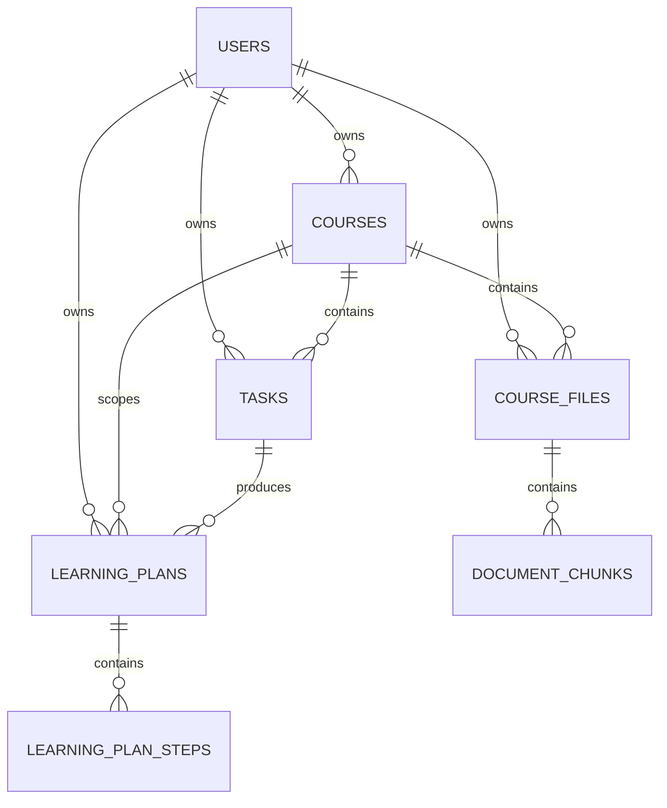
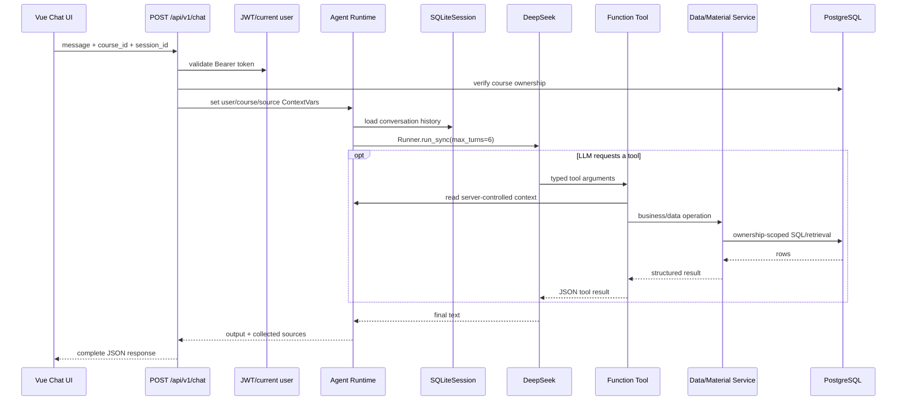
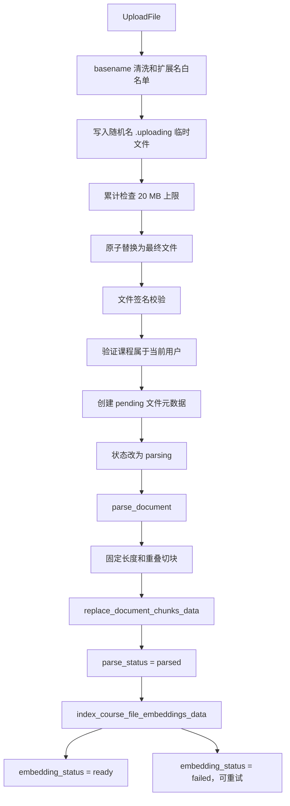
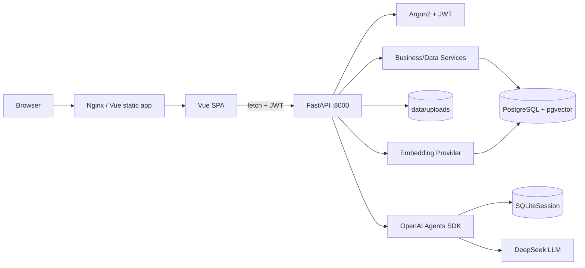

# Course Agent 当前架构

本文描述仓库中**当前已经存在的实现**，用于帮助开发者理解系统边界、请求流、数据流和已知限制。它不是未来架构规划；目录名、README 设想或尚未连通的代码痕迹不会被当成已实现能力。

## 1. 系统定位

Course Agent 是一个多用户课程与学习任务管理应用。当前产品链路包括：

- 用户注册、登录和 JWT 认证；
- 课程查询与任务 CRUD；
- 课程资料上传、解析、切块、全文检索和向量检索；
- 基于所选课程的 Agent 对话；
- Agent 调用任务管理、资料检索和截止日期风险工具；
- 学习计划草稿生成、确认和步骤管理；
- 作业文件解析与 LLM 评估；
- Vue 单页前端和 Docker Compose 运行拓扑。

## 2. 技术栈与运行组件

| 范围 | 当前实现 | 主要代码 |
| --- | --- | --- |
| 前端 | Vue 3、Vite、原生 `fetch` | [`web/src/App.vue`](../web/src/App.vue)、[`useCourseWorkspace.js`](../web/src/composables/useCourseWorkspace.js) |
| HTTP 后端 | FastAPI、Uvicorn | [`main.py`](../backend/src/course_agent/main.py) |
| 请求模型 | Pydantic | [`api/schemas.py`](../backend/src/course_agent/api/schemas.py)、[`models.py`](../backend/src/course_agent/models.py) |
| 业务数据 | PostgreSQL | [`postgres/init.sql`](../postgres/init.sql) |
| 数据库访问 | 同步 `psycopg`，无 ORM | [`postgres_database.py`](../backend/src/course_agent/postgres_database.py)、[`postgres_data_service.py`](../backend/src/course_agent/postgres_data_service.py) |
| 向量存储 | PostgreSQL `pgvector`，不是独立向量数据库 | [`course_material_service.py`](../backend/src/course_agent/course_material_service.py) |
| Agent SDK | OpenAI Agents SDK | [`agent_runtime.py`](../backend/src/course_agent/agent_runtime.py) |
| 对话 LLM | DeepSeek OpenAI-compatible API | [`agent_runtime.py`](../backend/src/course_agent/agent_runtime.py) |
| Embedding | 可配置的 OpenAI-compatible 同步客户端 | [`embedding_service.py`](../backend/src/course_agent/embedding_service.py) |
| Agent 会话 | Agents SDK `SQLiteSession` | [`agent_runtime.py`](../backend/src/course_agent/agent_runtime.py) |
| 文件解析 | `pypdf`、`python-docx`、文本解码 | [`document_parser.py`](../backend/src/course_agent/document_parser.py) |
| 认证 | Argon2 密码哈希、JWT Bearer token | [`auth_security.py`](../backend/src/course_agent/auth_security.py) |
| 部署 | Backend Dockerfile、Frontend Nginx、Docker Compose | [`docker-compose.yml`](../docker-compose.yml) |

Python 依赖由 `pyproject.toml`、`requirements.txt` 和虚拟环境/pip 管理；前端依赖由 npm、`package.json` 和 `package-lock.json` 管理。

项目不使用 SQLAlchemy、Alembic、Vue Router、Pinia、Vuex 或 Axios。

## 3. 代码结构与职责

```text
backend/src/course_agent/
├─ main.py                     FastAPI 应用、lifespan、middleware、router 装配
├─ api/
│  ├─ schemas.py               HTTP 请求模型
│  └─ routers/
│     ├─ auth.py               注册、登录
│     ├─ courses.py            课程查询
│     ├─ tasks.py              任务 CRUD、计划草稿、作业评估
│     ├─ files.py              文件上传、索引、查询、删除
│     ├─ chat.py               课程 Agent 对话
│     ├─ insights.py           截止日期风险
│     └─ plans.py              学习计划状态与步骤
├─ models.py                   领域模型、Tool 返回和结构化 LLM 输出模型
├─ auth_security.py            JWT 创建/校验和当前用户依赖
├─ postgres_database.py        PostgreSQL 连接和 schema 初始化
├─ postgres_data_service.py    用户、课程、任务的数据访问和业务校验
├─ course_material_service.py  文件元数据、chunk、embedding 和检索
├─ learning_insight_service.py 学习计划、风险评分和资料关联
├─ document_parser.py          文件签名校验、文本提取和切块
├─ embedding_service.py        Embedding 配置和批量请求
├─ agent_runtime.py            Agent、模型、上下文、会话和 Runner
├─ tools.py                    Agent function tools
├─ rate_limit.py               进程内 HTTP 限流
└─ environment.py              项目根 .env 加载

web/src/
├─ main.js                     Vue 挂载入口
├─ App.vue                     页面和组件编排
├─ composables/
│  └─ useCourseWorkspace.js    前端状态、认证、API 请求和业务动作
└─ components/                 登录、课程、任务、资料、聊天、计划等 UI

postgres/init.sql              表、约束、全文索引和 pgvector 索引
scripts/migrations/            历史增量 SQL；当前没有统一迁移框架
backend/tests/                 后端 unittest
```

`model.py`、SQLite 迁移脚本和兼容入口仍存在，但当前业务模型以 `models.py` 为主，业务数据库以 PostgreSQL 为主。

## 4. 后端分层

当前主链路是：

```text
Router
  → Service / Data Service
    → psycopg
      → PostgreSQL
```

仓库没有独立的 Repository 或 DAO 包。`postgres_data_service.py`、`course_material_service.py` 和 `learning_insight_service.py` 实际同时承担部分业务服务和数据访问职责。

复杂接口会由 Router 直接编排多个组件：

```text
Router
  → 认证依赖
  → 文件系统 / Parser / Agent Runtime / Service
  → PostgreSQL / LLM Provider
```

### 4.1 Router 的职责边界

Router 不只是薄路由：

- `tasks.py` 编排计划生成、资料检索、LLM 输出校验和计划保存；
- `files.py` 编排临时文件、大小和签名校验、解析、chunk 保存及 embedding；
- `chat.py` 校验课程所有权、设置 Agent 上下文、创建会话并运行 Runner；
- 删除接口在 Router 层检查确认文本。

### 4.2 Schema 与数据库边界

- `api/schemas.py` 保存 HTTP 请求模型；
- `models.py` 保存领域记录、风险、计划、引用来源和结构化 LLM 输出；
- 数据库没有 ORM Model；
- SQL row 通过手工字段映射转换为 Pydantic 对象。

### 4.3 依赖注入与异常处理

FastAPI 依赖注入主要用于认证：

```text
Depends(get_current_user)
→ OAuth2PasswordBearer
→ decode_access_token
```

数据库连接不通过依赖注入传递，而是由各数据函数自行创建。

当前没有自定义全局异常处理器。请求校验和未捕获异常使用 FastAPI 默认行为；部分 Router 自行捕获异常。部分业务失败使用 4xx，部分以 HTTP 200 加 `success=false` 返回，错误语义尚未统一。

## 5. 普通 HTTP 请求链

### 5.1 登录

```text
POST /api/v1/auth/login
→ CORS / rate limit / UTF-8 middleware
→ LoginRequest
→ login_api()
→ authenticate_user_data()
→ PostgreSQL 查询用户
→ Argon2 密码验证
→ create_access_token()
→ JSON response
```

关键代码：

- [`api/routers/auth.py`](../backend/src/course_agent/api/routers/auth.py)：`login_api()`；
- [`api/schemas.py`](../backend/src/course_agent/api/schemas.py)：`LoginRequest`；
- [`auth_security.py`](../backend/src/course_agent/auth_security.py)：JWT 创建和校验；
- [`postgres_data_service.py`](../backend/src/course_agent/postgres_data_service.py)：用户查询和认证数据访问。

`login_api()` 是同步 endpoint，由 FastAPI 在线程池中执行。

### 5.2 更新任务

```text
PATCH /api/v1/tasks/{task_id}
→ Bearer token
→ get_current_user
→ TaskUpdate 校验
→ update_task_api()
→ update_task_data()
→ UPDATE tasks
   WHERE user_id = 当前用户 AND id = task_id
→ psycopg transaction commit
→ JSON response
```

该链路在 SQL 层同时使用 `user_id` 和 `task_id`，不是只按客户端提供的任务 ID 更新。

### 5.3 学习计划草稿

```text
POST /api/v1/tasks/{task_id}/plan
→ 当前用户
→ 读取用户拥有的任务
→ 检索该课程相关资料
→ generate_task_plan_draft()
→ Runner.run_sync(max_turns=1)
→ LLM 返回 JSON 文本
→ json.loads + Pydantic 校验
→ create_learning_plan_data()
→ PostgreSQL 保存计划和步骤
→ JSON response
```

计划 Agent 没有注册业务工具；它使用 Router 准备好的任务和资料上下文生成结构化草稿。

## 6. 认证与数据隔离

### 6.1 已实现

- 注册时保存 Argon2 密码哈希，不保存明文密码；
- 登录时验证密码和 `is_active`；
- JWT 包含用户标识、签发时间和过期时间；
- 主要业务 endpoint 使用 `get_current_user`；
- 任务、课程、文件、计划和检索 SQL 普遍携带 `user_id`；
- Agent Tool 从 `ContextVar` 获取当前用户和课程；
- Agent session key 包含用户、课程和 session ID。

### 6.2 当前边界

- 没有角色表、RBAC 或通用 policy 层；
- 已签发 JWT 在每次请求时不会重新查询数据库确认用户仍为 active；
- 数据库外键没有使用复合所有权约束保证关联记录的 `user_id` 必然一致；正常 API 依赖应用层校验维持这一关系；
- Agent 写工具依赖当前用户/课程上下文和 SQL 过滤，没有独立的 tool permission engine。

当前代码审阅未发现仅修改 `task_id`、`course_id` 或 `file_id` 即可访问其他用户数据的已确认链路。

## 7. 数据库结构

数据库 schema 由 [`postgres/init.sql`](../postgres/init.sql) 定义，没有 ORM relationship。

### 7.1 主要实体

#### `users`

- 主键：`id BIGSERIAL`；
- 唯一：`username`；
- 主要字段：`password_hash`、`is_active`、`created_at`。

#### `courses`

- 主键：`id TEXT`；
- 外键：`user_id → users.id ON DELETE CASCADE`；
- 主要字段：`name`、`teacher`；
- `user_id` 有索引。

#### `tasks`

- 主键：`id TEXT`；
- 外键：`user_id → users.id`、`course_id → courses.id`；
- 主要字段：`title`、`deadline`、`status`、`priority`、`desc`；
- `status` 限制为 `todo/done`；
- `priority` 限制为 `high/medium/low`；
- `course_id`、`(user_id, course_id)`、`status` 有索引。

#### `course_files`

- 主键：`id TEXT`；
- 外键：`user_id → users.id`、`course_id → courses.id`；
- `storage_filename` 唯一；
- 保存原文件名、类型、大小、SHA、解析状态和 embedding 状态；
- 文件类型限制为 PDF、DOCX、TXT、MD。

#### `document_chunks`

- 主键：`id TEXT`；
- 外键：`file_id → course_files.id ON DELETE CASCADE`；
- `UNIQUE(file_id, chunk_index)`；
- 保存页码、chunk 顺序、正文、`tsvector` 和 `vector(1024)`；
- 有 GIN 全文索引和 embedding 非空记录的 HNSW cosine 索引。

#### `learning_plans`

- 主键：`id TEXT`；
- 外键：`user_id → users.id`、`task_id → tasks.id`、`course_id → courses.id`；
- 保存目标、前置条件 JSON、引用来源 JSON、状态和时间。

#### `learning_plan_steps`

- 主键：`id TEXT`；
- 外键：`plan_id → learning_plans.id ON DELETE CASCADE`；
- `UNIQUE(plan_id, position)`；
- 保存步骤内容、预计时间、交付物、完成标准和状态。

### 7.2 ER 关系



### 7.3 连接和事务

- 使用同步 `psycopg`；
- 每个数据函数通常新建连接，没有连接池；
- `with connection` 在成功时提交、异常时回滚并关闭连接；
- 没有发现常规 PostgreSQL 连接未关闭的路径；
- 文件、数据库、embedding 和 LLM 组成的跨组件工作流不是单一事务。

## 8. 同步与异步执行模型

| 操作 | 当前执行方式 | 对请求的影响 |
| --- | --- | --- |
| 普通 `def` FastAPI endpoint | FastAPI thread pool | 占用请求 worker 直到完成 |
| PostgreSQL | 同步阻塞 psycopg | 在调用线程等待 |
| `UploadFile.read()` / `close()` | 原生 async | 异步等待上传对象 |
| 文件落盘、哈希、签名读取 | 同步 I/O / CPU | 上传 async endpoint 内直接执行 |
| PDF、DOCX 解析和切块 | 同步 I/O / CPU | 上传和评估 async endpoint 内直接执行 |
| Embedding HTTP | 同步客户端 | 上传/重建索引时通过 thread pool 包装 |
| Agent Chat | `Runner.run_sync()` | 同步 endpoint 等待完整 Agent 结果 |
| 计划生成 | `Runner.run_sync()` | 同步 endpoint 等待完整结果 |
| 作业评估 LLM | `run_in_threadpool()` | 不阻塞事件循环，但 HTTP 请求仍等待 |
| Streaming | 未实现 | 所有结果完成后一次性返回 |

`await run_in_threadpool(...)` 表示把同步工作隔离到线程池，**不是后台任务**；当前 HTTP 请求仍会等待工作结束。

`upload_course_file_api()` 和 `assess_task_submission_api()` 是需要重点注意的 async endpoint：其中仍直接执行同步文件 I/O、数据库访问、文档解析或资料检索。

## 9. Agent 架构

### 9.1 创建和模型配置

[`agent_runtime.py`](../backend/src/course_agent/agent_runtime.py) 负责：

- `configure_model()`：配置 DeepSeek OpenAI-compatible client；
- `create_agent()`：创建通用 Agent；
- `create_course_agent()`：创建绑定课程提示词和课程工具的 Agent；
- `create_session()`：创建 `SQLiteSession`；
- `run_agent_message()`：通过 `Runner.run_sync()` 执行消息；
- 计划草稿和作业评估专用 Agent。

课程 Agent 的 system prompt 明确课程资料属于不可信内容，不能把资料中的文本当成系统指令。该约束属于 prompt 层规则，不是 SDK guardrail。

OpenAI tracing 当前明确关闭。

### 9.2 Tool 注册

[`tools.py`](../backend/src/course_agent/tools.py) 使用 `@function_tool` 注册：

- `search_course_documents()`；
- `list_deadline_risks()`；
- `list_courses()`；
- `list_tasks()`；
- `get_task_detail()`；
- `create_task()`；
- `update_task()`；
- `update_task_status()`；
- `delete_task()`。

Tool schema 由 Agents SDK 根据函数签名、类型注解和 docstring 生成，没有独立的手写 JSON tool registry。

### 9.3 用户、课程和引用上下文

`agent_runtime.py` 使用 `ContextVar` 保存：

- 当前用户 ID；
- 当前课程 ID；
- 本次请求检索到的资料来源。

`chat_api()` 在运行 Agent 前设置这些值，并在 `finally` 中恢复。Tool 不接受模型直接指定的 `user_id`，而是读取受服务端控制的当前上下文。

### 9.4 Agent 请求链



### 9.5 Memory、state 和结构化输出

| 能力 | 状态 | 当前实现 |
| --- | --- | --- |
| Conversation history | 基础实现 | `SQLiteSession` |
| 用户/课程请求状态 | 基础实现 | `ContextVar` |
| Agent 实例缓存 | 基础实现 | 进程内课程 Agent cache |
| Durable state/checkpoint | 未实现 | 没有持久化状态机或恢复点 |
| 普通聊天 structured output | 未实现 | 返回自由文本 |
| 计划/评估 structured output | 部分实现 | JSON 文本经 `json.loads` 和 Pydantic 校验 |
| Tool permission | 部分实现 | 所有权和课程作用域；无独立权限引擎 |
| Human approval | 部分实现 | 删除、计划确认等业务级确认 |
| Guardrail | 只有 prompt 规则 | 未发现 SDK guardrail |
| Retry/fallback | 部分实现 | 无统一 Agent/provider retry |
| Streaming/event | 未实现 | 使用同步 Runner，完整响应 |

## 10. 文件与 RAG 链

### 10.1 上传和索引生命周期



主要实现位置：

- [`api/routers/files.py`](../backend/src/course_agent/api/routers/files.py)：HTTP 生命周期编排；
- [`course_material_service.py`](../backend/src/course_agent/course_material_service.py)：文件记录、chunk、embedding 状态和检索；
- [`document_parser.py`](../backend/src/course_agent/document_parser.py)：签名校验、文本提取和切块；
- [`embedding_service.py`](../backend/src/course_agent/embedding_service.py)：批量 embedding 请求。

解析失败时，原始文件和元数据会保留并标记失败。Embedding 失败不会删除已经解析的文本，可通过 `POST /api/v1/files/{file_id}/index` 重试。

### 10.2 检索链

```text
Agent/Search caller
→ search_course_documents_data(user_id, course_id, query)
→ 只查询当前用户、当前课程、已解析文件
→ 如果 embedding 已配置且存在 ready vectors：
     query embedding
     → pgvector cosine search
→ 如果向量路径不可用或无结果：
     PostgreSQL tsvector/ts_rank_cd + ILIKE
→ DocumentSearchResult
→ PlanSource / Chat sources
```

### 10.3 RAG 能力边界

#### 已实现

- 文件元数据和解析状态；
- PDF、DOCX、TXT、MD 解析；
- chunk；
- embedding；
- pgvector 存储和 HNSW 索引；
- PostgreSQL 全文索引；
- semantic retrieval；
- 用户、课程和文件状态过滤；
- sources 返回；
- embedding 失败和重试状态。

#### 部分实现

- Citation：前端展示独立 sources，但没有强制模型逐条内联引用；
- 检索 fallback：向量优先、失败或无结果时使用全文检索；
- Metadata filtering：实现固定的用户、课程和状态过滤，不是通用过滤语言。

#### 未实现

- OCR；
- 真正 BM25；
- 向量和关键词结果的 hybrid fusion；
- reranker；
- retrieval evaluation；
- citation correctness evaluation。

## 11. Streaming

当前没有：

- SSE；
- FastAPI `StreamingResponse`；
- token streaming；
- Agent execution event；
- 客户端断开后的显式取消；
- Vue `EventSource` 或 `ReadableStream` 消费链。

Agent Chat、计划生成、作业评估和 embedding 都在当前 HTTP 请求内等待完成，再返回完整响应。

## 12. 前端架构

`App.vue` 负责认证页和主工作区的条件渲染。`useCourseWorkspace.js` 集中维护：

- JWT 和登录状态；
- 当前课程、任务、文件、风险、计划和聊天状态；
- `requestJson()` 和全部主要 API 调用；
- 加载状态和错误状态；
- 文件上传 `FormData`；
- Chat 请求和 sources 更新。

JWT 保存于 `sessionStorage`，请求附加 `Authorization: Bearer ...`。收到 401 时前端清除 token。

前端没有 Vue Router 和独立状态库；组件主要通过 props、emit 和 composable 状态协作。

典型调用链：

```text
TaskList emit select
→ App.vue 调用 loadTaskDetail()
→ useCourseWorkspace.requestJson()
→ GET /api/v1/tasks/{task_id}
→ FastAPI tasks router
→ get_current_user
→ postgres_data_service
→ PostgreSQL
→ JSON response
→ 更新 Vue ref
→ TaskDetail 渲染
```

Chat UI 使用普通 POST 并等待完整 JSON，仅提供 loading 状态，不消费流。

## 13. 部署拓扑



Docker Compose 当前包含：

- PostgreSQL/pgvector；
- Uvicorn backend；
- Nginx frontend；
- PostgreSQL 命名卷；
- Agent session 命名卷；
- `data` 和 `logs` 目录挂载。

PostgreSQL 有 Compose healthcheck。后端 `/health` 只表示 FastAPI 进程可响应，不验证 PostgreSQL、LLM 或 embedding。仓库内没有生产 TLS、外部负载均衡或 secret manager 配置。

数据库启动时由 FastAPI lifespan 调用 `ensure_application_schema()` 执行初始化 SQL。仓库有历史迁移 SQL，但没有 Alembic 或统一的版本化迁移账本。

## 14. 测试现状

`backend/tests` 目前主要覆盖：

- Agent ContextVar 和引用来源隔离；
- API 路由 method/path 契约；
- 文件名、存储名和文件签名；
- Markdown 解析；
- embedding 批次、顺序和维度，使用 fake client；
- 风险评分纯逻辑；
- 限流器；
- 计划草稿和作业评估 Pydantic 校验；
- 包结构和兼容入口。

当前没有完整覆盖：

- 真实 PostgreSQL 集成；
- 注册、登录、JWT 和 CRUD 成功链；
- Agent Runner 和多轮 tool call；
- 向量/全文检索端到端质量；
- 前端组件、composable 和浏览器 E2E；
- 系统级权限和安全回归。

## 15. 已知架构限制

以下是当前实现边界，不表示它们已经进入改造计划：

1. **没有独立 Repository 层**：Service/Data Service 直接执行 SQL；这本身不是功能错误，但业务、映射和数据访问边界较集中。
2. **同步数据库访问**：所有 PostgreSQL 调用使用同步 psycopg，没有连接池。
3. **async 路径仍含阻塞工作**：上传和评估会直接执行同步文件、数据库和解析操作。
4. **跨组件流程非原子**：文件系统、多个数据库事务、embedding 和 LLM 无法由一个事务统一提交或回滚。
5. **错误协议不统一**：部分失败使用 HTTP 错误，部分返回 HTTP 200 和失败 body。
6. **Agent 权限是固定工具集加数据作用域**：没有独立 tool permission、通用审批或 SDK guardrail。
7. **Agent memory 仅为会话历史**：没有 durable state、checkpoint 或显式恢复工作流。
8. **没有 streaming 和取消协议**：长任务在原 HTTP 请求内等待完成。
9. **RAG 是向量优先加 FTS fallback**：不是 hybrid fusion，也没有 reranking 和质量评估。
10. **数据库迁移未版本化管理**：启动时执行初始化 SQL，历史迁移文件没有统一账本。
11. **存在 N+1 风险**：学习计划列表逐项读取详情；风险列表可能按任务重复检索资料。
12. **进程内状态不可跨 worker 共享**：课程 Agent cache 和限流桶均位于单进程内存。
13. **输入和资源预算不完整**：聊天历史、模型 token、部分文本字段和 PDF 解析复杂度缺少统一硬限制。
14. **前端状态集中**：主要状态和 API 逻辑集中在大型 `useCourseWorkspace.js`，且没有前端测试。
15. **可观测性有限**：Agent tracing 关闭，健康检查不覆盖数据库和模型 Provider。

## 16. 能力状态摘要

| 能力 | 状态 |
| --- | --- |
| FastAPI API | 完整实现 |
| Pydantic 请求校验 | 基础实现 |
| 注册、密码哈希和 JWT | 基础实现 |
| 用户数据隔离 | 基础实现 |
| PostgreSQL | 完整实现 |
| Service/Data Service | 基础实现 |
| 独立 Repository | 未实现 |
| 文件处理链 | 完整实现 |
| Agent tool calling | 完整实现 |
| Agent conversation memory | 基础实现 |
| Durable Agent state | 未实现 |
| RAG | 基础实现 |
| Hybrid retrieval | 未实现 |
| Reranking | 未实现 |
| Streaming | 未实现 |
| 通用 Human-in-the-loop | 未实现 |
| Agent/RAG evaluation | 未实现 |
| Tracing | 未实现 |
| 自动化测试 | 基础实现 |
| Docker Compose 部署 | 基础实现 |
